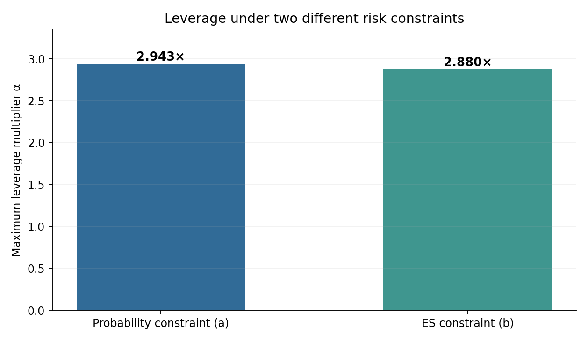
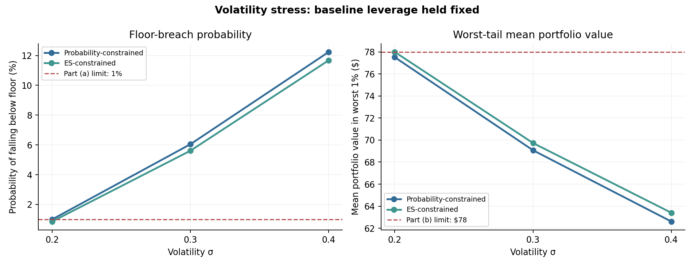

# CPPI Portfolio Insurance — Risk-Constrained Leverage

## Objective

How much exposure to a risky asset can a Constant Proportion Portfolio Insurance (CPPI) strategy take while respecting different downside-risk limits? 

Are these decisions robust to a rise in market volatility?

## Model

One-period CPPI with risky gross return $R=\exp(\mu+\sigma Z)$, $Z\sim N(0,1)$, and zero return on cash:

$$V_1=V_0+\alpha(V_0-G)(R-1).$$

- $G$: portfolio floor (the minimum desired future portfolio value)
- $V_0-G$: cushion (capital above the floor)
- $\alpha$: leverage multiplier applied to the cushion
- Baseline $\mu=0.05$, $\sigma=0.20$, $p=0.01$
- Illustrative assumptions: $V_0=\$100$, $G=\$80$, $\gamma=0.10$
- Risk Tolerance Parameter: $\gamma$ = 0.1
## Methods and results

| Risk rule | Maximum leverage | Risky allocation* | Cash allocation* |
|---|---:|---:|---:|
| (a) Floor-breach probability $\leq 1\%$ | **2.9426×** | $58.85 | $41.15 |
| (b) ES constraint, $\gamma=0.10$ | **2.8800×** | $57.60 | $42.40 |

*Dollar allocations are for the illustrative $100 portfolio and $80 floor*

For (b), the ES condition is equivalent to requiring that the **average portfolio value in the worst 1% of outcomes is at least $78**. This is the $80 floor minus 10% of the $20 cushion. 



## Analysis Figure 1 — Maximum Leverage under Different Risk Constraints

The probability-based constraint allows a maximum leverage of 2.943, compared with 2.880 under the ES constraint (γ = 0.10). In this setting, the ES-based approach results in a slightly more conservative allocation by limiting the severity of extreme downside outcomes rather than only the probability of breaching the portfolio floor.

## Volatility stress test

Keeping each leverage multiplier fixed at its baseline-calibrated value, we increase volatility from 20% to 30% and 40% while keeping $\mu$ fixed.



| $\sigma$ | Strategy (a): floor breach | Strategy (b): floor breach | Strategy (a): mean wealth, worst 1% | Strategy (b): mean wealth, worst 1% |
|---|---:|---:|---:|---:|
| 0.20 | 1.00% | 0.86% | $77.52 | $78.00 |
| 0.30 | 6.05% | 5.61% | $69.08 | $69.73 |
| 0.40 | 12.24% | 11.68% | $62.61 | $63.40 |


**Finding:** The baseline-approved multipliers do not remain safe under higher volatility. An ES constraint limits average lower-tail loss, while the probability constraint limits the frequency of breaching the floor. Neither rule guarantees protection when the assumed return distribution changes.

The baseline-calibrated leverage multipliers become insufficient to maintain the original risk limits as market volatility increases. Both floor-breach probability and extreme downside losses rise significantly under stress.

Risk limits are only as reliable as the assumptions used to calibrate them. This highlights the importance of stress testing and reassessing leverage when market conditions change.


## Run locally

```bash
pip install -r requirements.txt
jupyter notebook CPPI_Risk_Analysis.ipynb
```

Run all cells from the project folder. The notebook reproduces the numerical results and saves the figures under `figures/`.

## Scope / limitations

- One-period, lognormal gross returns; not calibrated to market data
- Fixed floor and zero interest on cash
- Analytic parameter stress test, **not** a historical backtest or Monte Carlo simulation
- Ignores transaction costs, jumps, slippage, and multi-period CPPI rebalancing

